# India's Heat Record

How India's heat changed, station by station, measured in ClickHouse on **1.07 billion station-days** of NOAA weather records.

[](https://github.com/Ritik650/india-heat-record/actions/workflows/tests.yml)

**[Open the live site](https://ritik650.github.io/india-heat-record/)** | [Read the two-page brief](outputs/india_heat_record_brief.pdf) | [Where the data disagreed with the plan](docs/plan_corrections.md)

IMD confirmed 2024 as India's warmest year since 1901, and heatwave counts make headlines every summer. This project tests the common claims on the public station record, and checks that record before trusting it.

## What it found

Heatwave days did rise, by about a third to a half, in line with IMD's own count. But this public record carries an undocumented reporting artefact that switches on region by region, and it took station-by-station checks to see it.

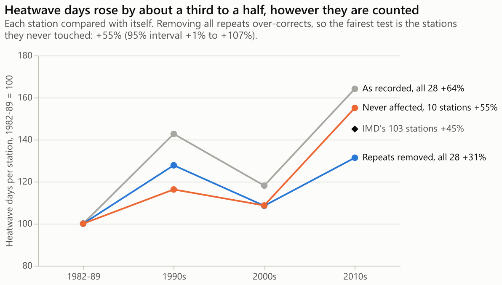

A daily maximum identical to the day before normally covers about 4% of days. At 23 stations it jumps from 14% in November 2010 to 31% a month later, holds for five years, and falls away in early 2016. Minimums at the same stations never move.

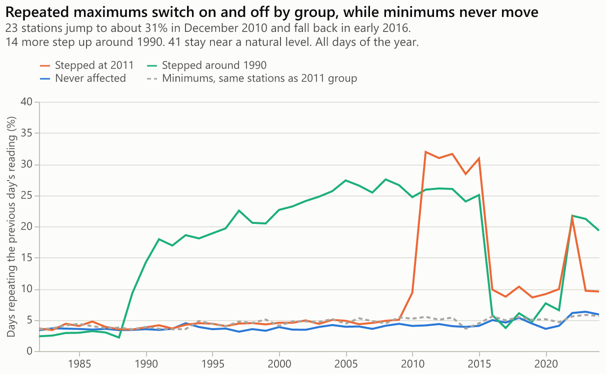

The stations affected follow regional lines, which weather does not: 22 of the 23 in the area of IMD's Chennai centre, and none of Maharashtra's 7.

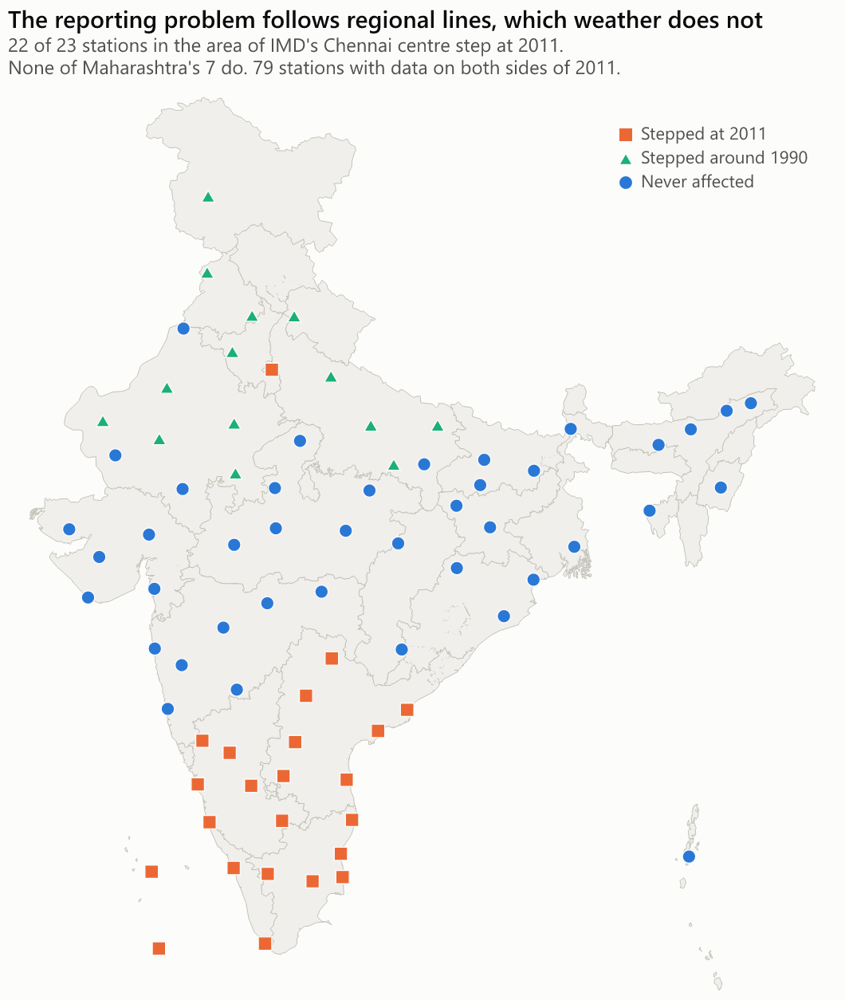

| Question | Answer, for these stations |
|---|---|
| Are heatwave days becoming more frequent? | Probably, by about a third to a half from 1982-89 to the 2010s. As recorded +64%. With every repeat removed +31% (95% interval -6% to 70%), which over-corrects. At the 10 stations repeats never touched +55% (interval 1% to 107%). IMD's own count at 103 stations: +45%. |
| Are nights warming faster than days? | No. Days +0.28°C a decade, nights +0.21°C, and nights led at 11 of 31 stations. At the 13 clean stations the two are level (+0.28 and +0.27°C). |
| Is summer starting earlier? | Not clearly. First 40°C moved -0.9 days a decade (95% interval -2.5 to +1.2), and years swing by far more than that. |
| Is monsoon rain getting more extreme? | No clear sign in either window that can be tested. Across 1,714 gauges, 1901-1970, heavy days went from 0.79 to 0.84 a season. Across 76 stations, 2006-2024, they moved +0.04 a decade (interval -0.07 to +0.15). A reporting break means the two cannot be joined. |
| Which stations are warming fastest? | Jaipur (+0.49°C a decade), then Veraval, Machilipatnam and Thiruvananthapuram. 28 of 31 stations warmed. |
| How does India compare? | Rank 33 of 38 countries at +0.24°C a decade, against a median country of +0.40°C, under one rule for all. Using clean stations alone: rank 28. |

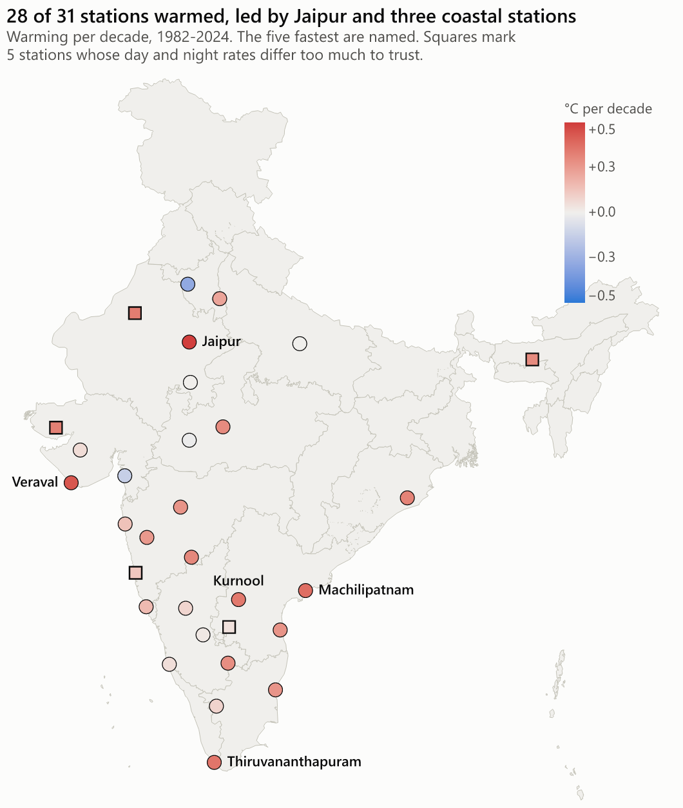

These results describe the stations named, not all of India. The [brief](outputs/india_heat_record_brief.pdf) sets out the limits.

## The artefact

This is the project's main discovery, and five separate tests point the same way. They all use this one dataset, and no document found so far describes the problem, so the cause is inferred.

| Test | Result |
|---|---|
| **All or nothing** | 23 of 79 stations jump by 10 points or more at 2011. 0 jump by 5 to 15 points. Stations either have it or do not. |
| **Sudden** | 14% in November 2010, 31% in December, then 32% in December 2015, 20% in January 2016, 8% in March. |
| **Regional** | 22 of 23 stations in the area of IMD's Chennai centre, plus New Delhi. None of Maharashtra's 7. A separate group of 14 in the north-west steps up around 1990. |
| **Only maximums** | At the same stations and dates, minimums repeat at 4.7% before and 4.8% during. Maximums go from 5.2% to 30.7%. |
| **On peaks** | Repeated maximums sit on local peaks 5.7 times as often as on local troughs, against 1.3 at clean stations and 1.2 for minimums at the same stations. A 24-hour window that catches the previous day's peak would do exactly this. |

Compared with clean stations, the day-night gap at the stations that jumped widens by 0.3°C in 2011-15 (95% interval 0.04 to 0.56), so it reaches mean temperatures too, not just threshold counts.

My first explanation was a peak carried forward in time, and I predicted the reading after a repeated pair would be lower more often than the reading before it. It was not: the two match. That test ruled out the simple version, and led to the local-peak test above.

## Each question's chart

The rise is uneven. New Delhi, Bhubaneswar and Jaipur rose most with repeats removed, while 12 of the 28 stations average under one heatwave day a season in both 1982-89 and the 2010s.

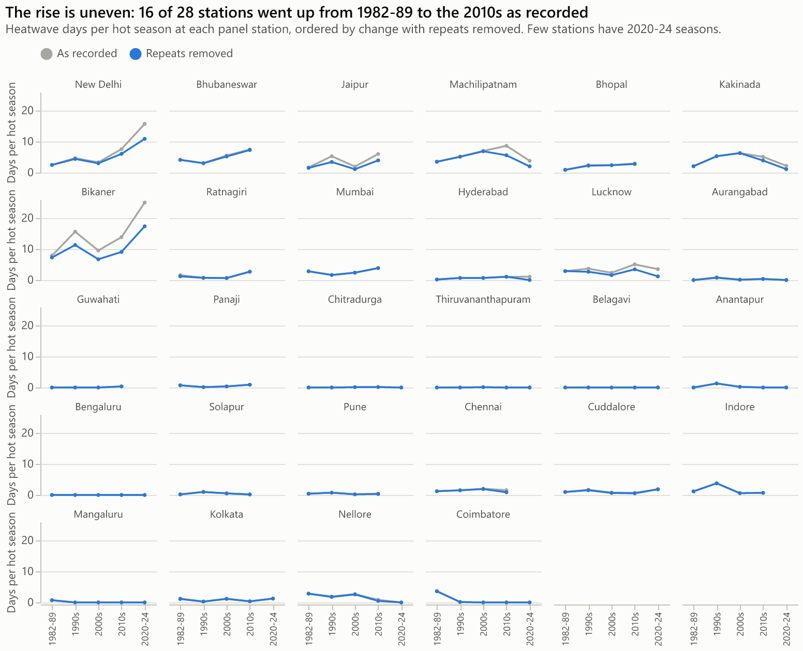

Most stations warmed faster by day than by night, though much of that gap comes from stations with the reporting problem.

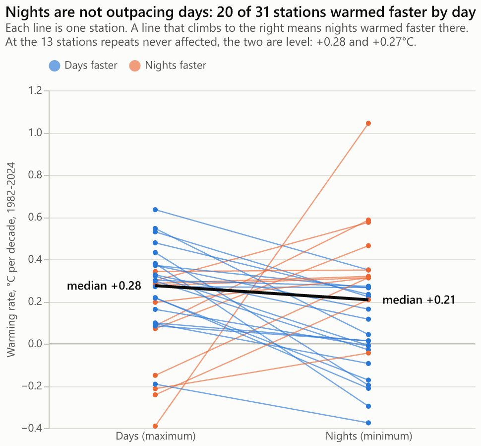

Summer's first 40°C swings by weeks from year to year, with no clear drift.

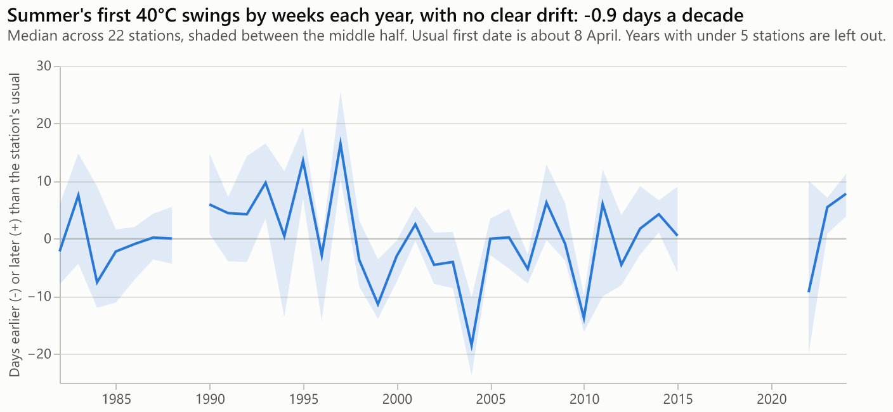

Across the complete gauge record, rainy days held steady and heavy days barely moved.

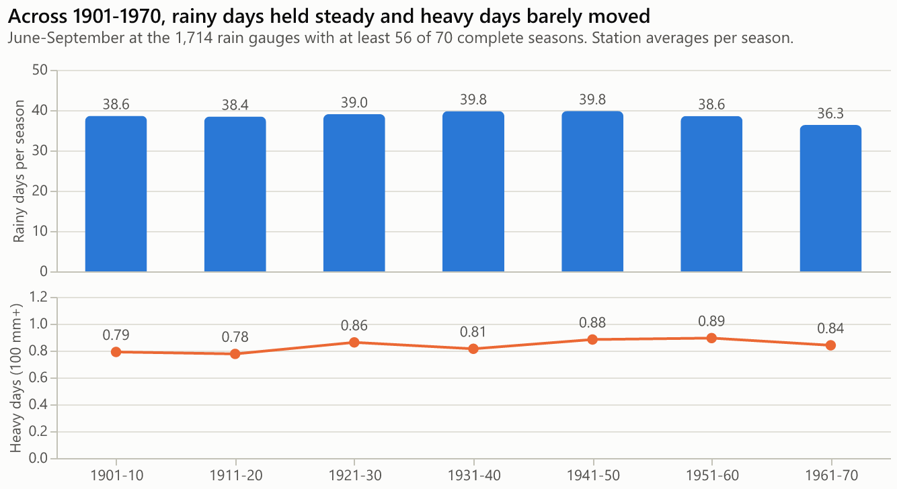

After 1972 the same stations appear to lose over a third of their rain and later recover, so no trend is drawn across that break.

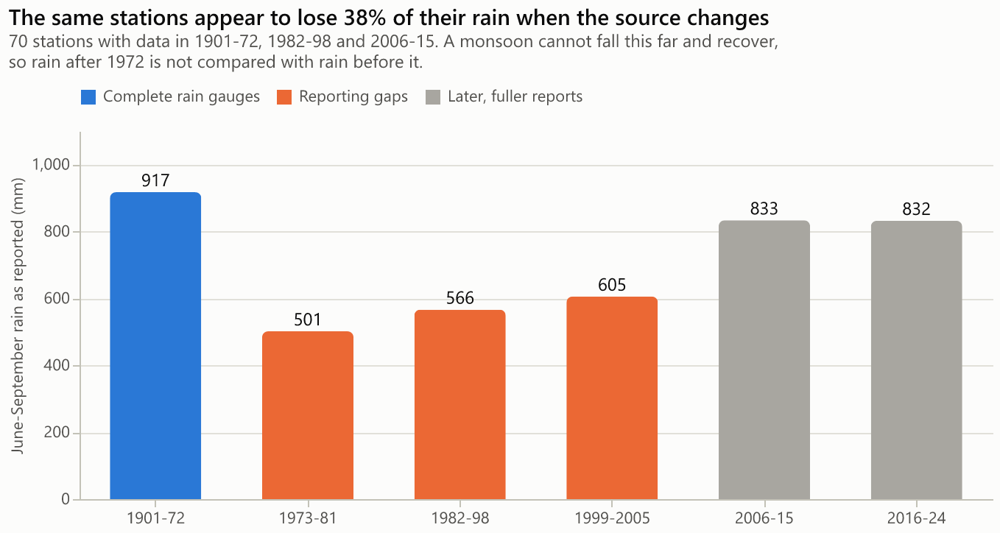

India's stations warmed more slowly than most countries', under one rule for all.

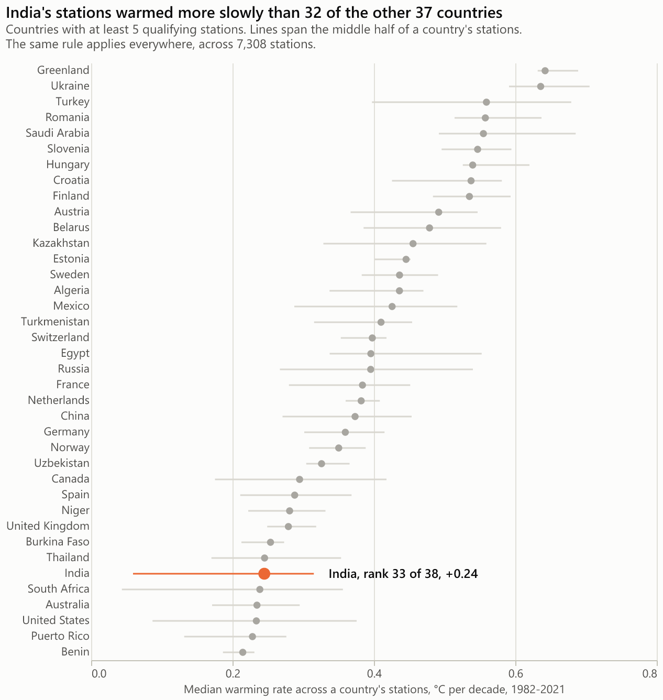

## Why the data needed checking

The headline number was wrong before the first query ran. The widely quoted 2.68B is a count of measurements. The table has 1,074,089,837 rows, one per station per day, and it came from a 2.28 GB file, not the documented 6.4 GB.

| What was found | How it was caught | What changed |
|---|---|---|
| A missing reading is stored as 0 | `tempMax = 0` appears 60,207,581 times in India, against once at +0.1°C | Zeros become NULL before any mean or threshold |
| The 1961-1990 baseline cannot be built | No Indian station has 20 complete years in it | Normals use 1991-2020, as IMD now does |
| Every maximum from 1973 to 1981 is a whole degree | Share of whole-degree values by year | Threshold questions start in 1982 |
| Repeated readings switch on by region | Share of days equal to the day before, by station and month | Heat counts are shown as recorded, with repeats removed, and at stations never affected |
| Rain halves when the source changes | The same 70 stations, compared across NOAA's sources | Rain after 1972 is not compared with rain before it |
| The source changes again in 2025 | NOAA's flags, kept in its raw files | Temperature stops at December 2024 |

All 15 checks are in the [issue log](docs/issue_log.csv), including those that passed, and [plan_corrections.md](docs/plan_corrections.md) records every departure from the original plan.

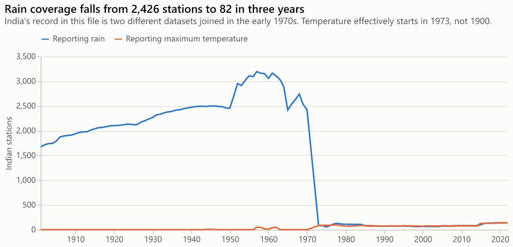

## The OLAP design

One raw table, two rollups kept current by materialized views, and small result tables for the dashboard.

```sql
CREATE TABLE heat.noaa
(
    station_id    LowCardinality(String) CODEC(ZSTD(1)),
    date          Date32 CODEC(DoubleDelta, ZSTD(1)),
    tempMax       Int32 CODEC(ZSTD(1)),
    tempMin       Int32 CODEC(ZSTD(1)),
    precipitation UInt32 CODEC(T64, ZSTD(1))
    -- and the remaining columns: sql/01_schema.sql
)
ENGINE = MergeTree
PARTITION BY intDiv(toYear(date), 10)
ORDER BY (station_id, date);
```

All 1,074,089,837 rows take **1.88 GB**, from 46 GB uncompressed and smaller than the source Parquet. Testing on 30M rows, per-column codecs took 1.12 bytes a row, against 3.55 for ClickHouse's default.

### Benchmark

Median seconds on warm runs, with the same limits on each engine: 4 threads and 3 GB. These are the real times, including where DuckDB wins.

| Question | ClickHouse raw | ClickHouse rollup | DuckDB on Parquet |
|---|---:|---:|---:|
| India, every station-year, by key prefix | 1.08 | 0.12 | 0.59 |
| India, same result, plan's substring filter | 1.08 |  |  |
| One station's whole history | 0.08 | 0.07 | 0.12 |
| Every country by decade, full scan | 14.9 | 0.13 | 12.4 |
| Q6, first version: a join that runs the months step twice | 31.9 | 7.33 | 6.74 |
| Q6, rewritten: window function, in key order | 20.2 | 2.34 | 6.58 |

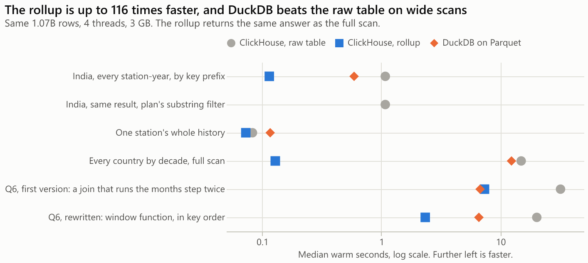

- **Rollups earn their place.** They answer the country scan about 115 times faster, with the same answer, and a test holds them to it.
- **DuckDB beats ClickHouse's raw table** on wide scans, reading the same data from a plain Parquet file. If the data is scanned rarely, that may be the simpler choice.
- **The first version of Q6 lost to DuckDB because of how it was written.** Its join ran the months step twice. A window function and in-order aggregation took the rollup from 7.33 s to 2.34 s.
- **A filter that misses the sort key costs most on its first run.** `substring(station_id, 1, 2) = 'IN'` cannot use the sort key, so a cold run reads all 1.07B rows where `LIKE 'IN%'` reads 62M, and takes 2.97 s against 1.38 s. Warm runs nearly match, because ClickHouse's query condition cache remembers which parts of the table matched.

## How much depends on the choices made

Rise in heatwave days, 1982-89 to the 2010s, when one assumption changes. IMD's rule was implemented a second time in Python, and it agrees with ClickHouse on every station-day.

| If this changes | Stations | As recorded | Repeats removed |
|---|---:|---:|---:|
| This project's rule | 28 | +64% | +31% |
| Normals from 1981-2010, not 1991-2020 | 28 | +72% | +36% |
| Normals not smoothed across 15 days | 28 | +55% | +21% |
| Hills from 600 m, not 1,000 m | 28 | +66% | +33% |
| Coast within 25 km, not 50 km | 28 | +67% | +34% |
| Coast within 100 km, not 50 km | 28 | +63% | +30% |
| The plan's simpler rule: 40 C and 4.5 C above normal, everywhere | 28 | +79% | +38% |
| Counted only in runs of 2 or more days, as IMD declares | 28 | +147% | +92% |
| Panel needs 2 seasons per period, not 3 | 33 | +71% | +39% |
| Panel needs 4 seasons per period, not 3 | 20 | +85% | +44% |
| Only stations repeats never affected | 10 | +55% | +59% |
| Leaving out stations that stepped at 2011 | 14 | +77% | +50% |

## Live site and dashboard

The [live site](https://ritik650.github.io/india-heat-record/) needs no server: results are built into one page and hosted on GitHub Pages. Its station explorer shows each station's own repeat history, so you can compare Chennai with Pune yourself.

A Grafana dashboard reads the same tables live from ClickHouse, with India's station map, one panel per question, the benchmark and the quality log. It runs locally, because hosting it means hosting ClickHouse.

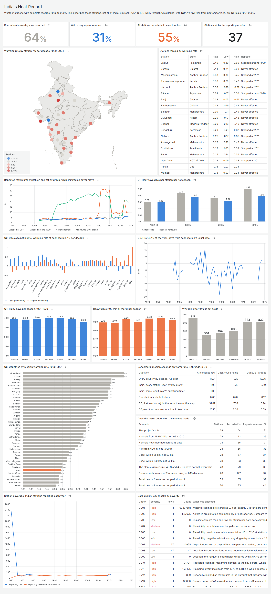

## Run it

ClickHouse has no Windows build, so on Windows it runs in WSL. A full build needs about 8 GB of disk on the Linux side, including space for merges.

```bash
# In Linux or WSL, from the repository. Run the two start scripts in their own terminals.
bash infra/install_clickhouse.sh
bash infra/start_server.sh
mkdir -p ~/heat/parquet
curl -o ~/heat/parquet/noaa_enriched.parquet https://datasets-documentation.s3.eu-west-3.amazonaws.com/noaa/noaa_enriched.parquet
~/heat/bin/clickhouse client --multiquery --queries-file sql/01_schema.sql
bash infra/load_parquet.sh
bash infra/install_duckdb.sh
bash infra/install_grafana.sh
bash infra/start_grafana.sh     # http://127.0.0.1:3000

# Then, with Python 3.11 or later:
python -m venv .venv && . .venv/bin/activate     # .venv\Scripts\activate on Windows
pip install -r requirements.txt
python pipeline/download_ghcn.py
python pipeline/load_reference.py
python pipeline/run_all.py --with-benchmark
pytest
```

On a 16 GB machine, run one heavy step at a time. WSL's default of half the machine's memory can exhaust Windows during the load, which grew the page file by over 5 GB in one step on the laptop this was built on. A `.wslconfig` with `memory=4500MB` under `[wsl2]` prevents that, and it needs `wsl --shutdown` to apply. It also limits Docker Desktop, so remove it afterwards. Tests that need ClickHouse skip themselves if it is not running.

## What's where

| Path | Contents |
|---|---|
| [sql/](sql/) | Schema and rollups, normals, heatwave logic, [quality checks](sql/dq_checks.sql), [the questions](sql/questions/), [benchmark queries](sql/benchmark/) |
| [pipeline/](pipeline/) | The steps from loading to the brief, run in order by `run_all.py` |
| [site/](site/) | The live site, built by `pipeline/build_site.py` and served by GitHub Pages |
| [dashboard/](dashboard/) | Grafana dashboard, generated by `build_dashboard.py` |
| [notebooks/](notebooks/) | How the data problems were found, with evidence, built by `build_notebook.py` |
| [data/mart/](data/mart/) | Aggregated results and `findings.json`, which every report reads from |
| [docs/](docs/) | [Methods](docs/methods.md), [data dictionary](docs/data_dictionary.md), [issue log](docs/issue_log.csv), [plan corrections](docs/plan_corrections.md), [sources](docs/sources.md) |
| [outputs/](outputs/) | The brief, charts and dashboard screenshot |
| [tests/](tests/) | IMD's rule at its boundaries, reconciliation, and reports against results |

## Data

NOAA GHCN-Daily, by Menne et al. (2012), through ClickHouse's Parquet and NOAA's per-station files. See [DATA_LICENSE.md](DATA_LICENSE.md). Row-level data is not committed. The code is under the [MIT licence](LICENSE).
